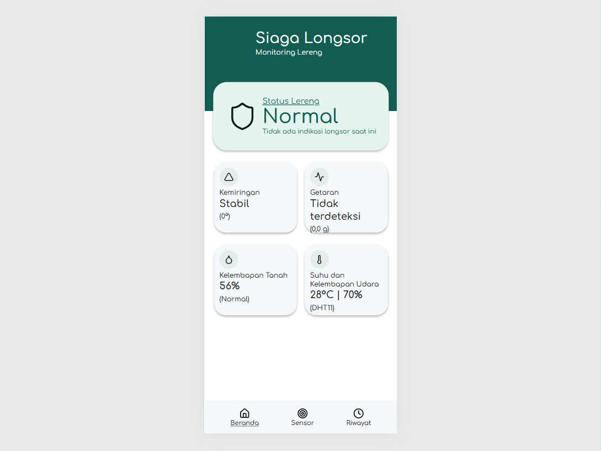
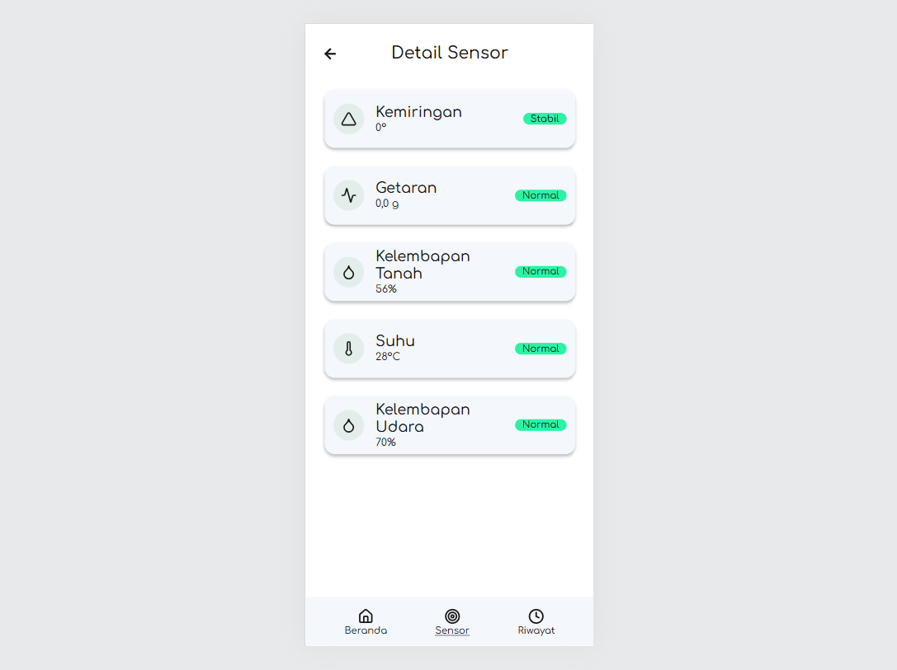
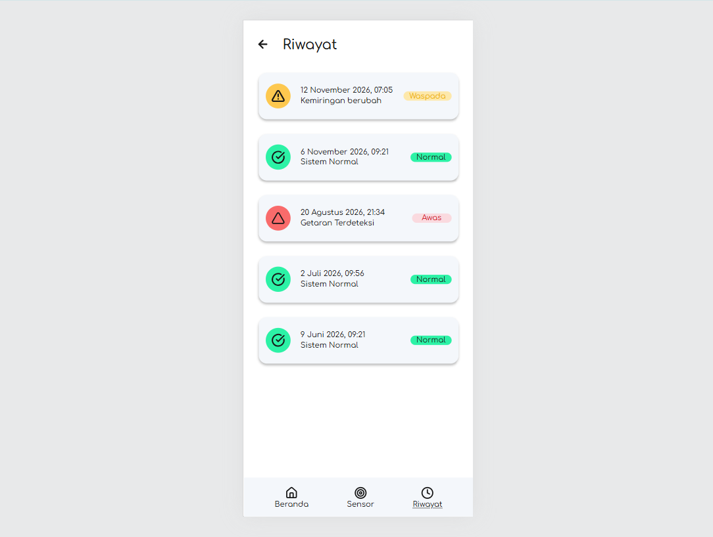

# Siaga Longsor: Monitoring Lereng

Aplikasi web berbasis **Laravel** untuk memantau kondisi lereng secara langsung dan memberi peringatan dini
ketika muncul tanda-tanda longsor.

---

## 1. Screenshot Landing Page

Landing page aplikasi adalah halaman **Dashboard (Beranda)**. Halaman ini menampilkan status lereng secara
ringkas (Normal, Waspada, atau Awas) beserta ringkasan data dari setiap sensor.

<p align="center">
  
</p>

### Halaman lainnya

| Detail Sensor | Riwayat |
|:---:|:---:|
|  |  |

---

## 2. Tema Proyek Kolaboratif

### Tema: Sistem Peringatan Dini Longsor (Monitoring Lereng)

Longsor sering terjadi tiba-tiba, padahal sebelumnya biasanya ada tanda-tanda awal: tanah bergeser,
tanah bergetar, dan tanah jenuh air setelah hujan. Tanda-tanda ini sulit diamati terus-menerus oleh manusia,
terutama di lereng yang jauh dari permukiman.

Proyek ini mengambil tema **pemantauan lereng berbasis sensor** agar tanda-tanda tersebut dapat dipantau
secara otomatis dan hasilnya mudah dibaca oleh masyarakat maupun petugas.

### Tujuan
- Memantau kondisi lereng hampir secara real-time.
- Memberi peringatan cepat (popup **Peringatan!**) saat terdeteksi kondisi berbahaya.
- Menyimpan riwayat kejadian agar pola kondisi lereng bisa ditinjau kembali.
- Menyajikan informasi dengan tampilan sederhana yang mudah dipahami semua kalangan.

### Cara kerja singkat
1. Alat sensor di lereng membaca **kemiringan, getaran, kelembapan tanah, suhu, dan kelembapan udara**
   (suhu dan kelembapan udara memakai sensor DHT11).
2. Alat mengirim data ke aplikasi melalui API (`POST /api/sensor`).
3. Aplikasi menghitung status lereng berdasarkan ambang batas, yaitu **Normal**, **Waspada**, atau **Awas**.
4. Jika status berubah, kejadian dicatat otomatis ke halaman **Riwayat**. Jika status **Awas**,
   popup peringatan muncul agar pengguna segera memeriksa kondisi di lokasi.

### Sisi kolaboratif
Proyek ini dikerjakan bersama oleh beberapa pihak dengan peran yang saling melengkapi, misalnya:
perangkat sensor dan pengiriman data, aplikasi web (backend dan tampilan), serta desain antarmuka.

| Nama | NIM |
|------|-------|
| Chandra Gusman Juliawan | 240160121014 |
| Didi Ramadhan Supardi | 240160121022 |
| Mohamad Ramdan Oktaviyadi | 240160121069 |
| Tedi Firmansah | 230660121140 |
| Rakean Pulia Gumelar | 240160121099 |

---

## 3. Fitur

- **Beranda:** status lereng dan ringkasan 4 kartu sensor.
- **Detail Sensor:** daftar kemiringan, getaran, kelembapan tanah, suhu, dan kelembapan udara beserta statusnya.
- **Riwayat:** daftar kejadian dengan penanda Normal, Waspada, dan Awas.
- **Popup Peringatan:** muncul otomatis saat status Awas, di halaman mana pun.
- **Pembaruan otomatis:** halaman memeriksa data baru setiap 5 detik.

## 4. Teknologi

- Laravel (Blade, Eloquent, Migration, Seeder)
- Tailwind CSS (via CDN) dan font Comfortaa
- Basis data MySQL/SQLite (sesuai konfigurasi `.env`)

---

## 5. Cara Menjalankan

1. Salin isi folder proyek ini ke project Laravel Anda (`app`, `config`, `database`, `resources`, `routes`).
2. Aktifkan route API (Laravel 11 ke atas):
   ```
   php artisan install:api
   ```
3. Atur `.env`:
   ```
   APP_TIMEZONE=Asia/Jakarta
   APP_LOCALE=id
   SIAGA_API_KEY=isi-kunci-rahasia-anda     # opsional
   ```
4. Migrasi dan isi data contoh:
   ```
   php artisan migrate --seed
   ```
5. Jalankan:
   ```
   php artisan serve
   ```
   Buka http://127.0.0.1:8000

## 6. Mengirim Data dari Alat

`POST /api/sensor` (JSON). Sertakan header `X-API-KEY` jika `SIAGA_API_KEY` diisi.

```json
{
  "kemiringan": 0,
  "getaran": 0.0,
  "kelembapan_tanah": 56,
  "suhu": 28,
  "kelembapan_udara": 70
}
```

Contoh uji (getaran tinggi memicu status **Awas** dan popup):

```
curl -X POST http://127.0.0.1:8000/api/sensor \
  -H "Content-Type: application/json" -H "Accept: application/json" -H "X-API-KEY: isi-kunci-rahasia-anda" \
  -d '{"kemiringan":2,"getaran":0.5,"kelembapan_tanah":60,"suhu":28,"kelembapan_udara":70}'
```

Ambang batas Waspada dan Awas dapat disesuaikan di `config/siaga.php`.

## 7. Struktur Penting

```
app/Services/SlopeStatus.php         logika penentuan status lereng
app/Http/Controllers/PageController  halaman Beranda, Sensor, Riwayat
app/Http/Controllers/Api/            API penerima data sensor
resources/views/                     tampilan Blade
config/siaga.php                     ambang batas dan API key
public/img/                          screenshot untuk README
```
